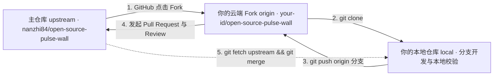
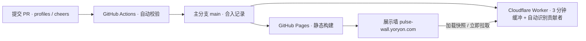

# Open Source Pulse Wall

一个一节课就能跑通完整开源闭环的 Git 协作实践项目。从 **Fork** 出发，亲手走完 **Clone → Branch → Validate → Commit → Push → Pull Request → Review → Merge** 全流程；每一次合并与互动都会实时点亮课堂展示墙。

- **在线协作展示墙**（课堂大屏直达）：<https://pulse-wall.yoryon.com/>
- **零基础图文教学页**：<https://pulse-wall.yoryon.com/guide.html>
- **拓展阅读 · 从零理解 Git 底层原理**：<https://yoryon.com/c/git-from-scratch/>

---

## 课堂四项任务

1. **上墙个人卡片**：在 `data/profiles/` 下创建自己的 JSON 卡片，完成人生第一个开源 PR。
2. **给同学写寄语**（Cheers）：在 `data/cheers/<同学用户名>/` 下留下一句鼓励，互相点亮寄语角标。
3. **提一个 Issue**：用仓库内置模板提问、报 Bug 或提改进想法。
4. **参与 PR Review**：邀请至少一位同学 Review 你的 PR，并给同学的 PR 留下一条 Review 评论。

---

## 拓扑结构

### 1. Git 开源协作拓扑（三仓联动）

开源协作和个人单机 Git 最大的区别，是同时存在 **主仓库**（`upstream`）、**你的云端 Fork**（`origin`）和 **你的本地仓库**（`local`）三个节点：



### 2. 展示墙实时同步拓扑

提交并合并 PR 后，展示墙如何自动识别你的头像、`@用户名` 并点亮大屏：



---

## 贡献步骤指南

> 想要看每一步带 GitHub 网页截图的手把手指引？直接打开 **[图文教学页](https://pulse-wall.yoryon.com/guide.html)**。

### 第一步：Fork & Clone

1. 点击本仓库右上角的 **Fork**，复制一份仓库到你自己的 GitHub 账号下。
2. 将你自己的 Fork 克隆到本地，并把主仓库添加为 `upstream`：

```bash
git clone https://github.com/<你的GitHub用户名>/open-source-pulse-wall.git
cd open-source-pulse-wall
git remote add upstream https://github.com/nanzhi84/open-source-pulse-wall.git
```

### 第二步：提交你的个人卡片（Profile）

切出新分支，复制模板文件（文件名使用你的 GitHub 用户名小写）：

```bash
git checkout -b add-my-profile
cp data/profiles/_template.json data/profiles/<你的GitHub用户名>.json
```

打开 `data/profiles/<你的GitHub用户名>.json`，只需填写 3 个字段：

```json
{
  "name": "你的名字",
  "motto": "今天完成我的第一个开源 PR",
  "city": "Beijing"
}
```

| 字段 | 必填 | 说明 |
| --- | --- | --- |
| `name` | 是 | 你的名字或昵称（最多 40 个字符，请勿保留默认值「你的名字」） |
| `motto` | 是 | 一句话介绍或座右铭（最多 120 个字符） |
| `city` | 否 | 所在城市或课堂位置（最多 40 个字符） |

> **头像与 `@GitHub用户名` 无需手填**：系统会自动读取创建该 JSON 文件的 PR 贡献者账号与 GitHub 头像。

本地运行校验（仅需 Node.js 18+，无需 `npm install`），通过后推送并发起 PR：

```bash
npm run validate
git add data/profiles/<你的GitHub用户名>.json
git commit -m "feat: add my contributor profile"
git push origin add-my-profile
```

回到 GitHub 页面点击 **Compare & pull request**，目标仓库确认是 `nanzhi84/open-source-pulse-wall` 的 `main` 分支。

### 第三步：给同学写寄语（Cheers）

等你的卡片合并后，给至少一位已经上墙的同学留一句寄语。每条寄语是一个独立 JSON 小文件——**不用填 `from` 和时间**，系统同样会根据提交该文件的 PR 自动识别你的 `@用户名`，而且多人同时给同一位同学写寄语完全不会发生 Git 冲突：

```bash
git fetch upstream
git checkout main
git merge upstream/main
git checkout -b cheer/octocat

mkdir -p data/cheers/octocat
cp data/cheers/_template.json data/cheers/octocat/<任意文件名>.json
```

打开该文件，只需写一行 `message`（80 字以内）：

```json
{
  "message": "你的 commit message 写得很清楚，赞！"
}
```

校验、提交并推送开 PR：

```bash
npm run validate
git add data/cheers/octocat/<任意文件名>.json
git commit -m "feat: cheer @octocat"
git push origin cheer/octocat
```

### 第四步：参与 Issue 与 PR Review

- **提一个 Issue**：打开仓库 [Issues 页面](../../issues/new/choose)，选择对应模板（提问 / 报 Bug / 改进想法 / 求救卡住）提交。
- **邀请同学 Review**：在你的 PR 页面右侧栏点击 `Reviewers` 齿轮图标，选择至少 1 位同学（也可在 PR 描述里 `@同学用户名` 请对方帮忙看）。
- **给同学做 Review**：点进任意同学的开放 PR，切到 `Files changed` 查看改动，留下一条友好的评论或 `Approve`。
- **修改后重新通知 Reviewer**：如果你根据意见更新了代码，记得点右侧 Reviewer 头像旁的 **循环箭头**（Re-request review），对方才会再次收到通知。

---

## 遇到分支落后或冲突怎么办？

当主仓库 `main` 已经合入了新提交、你需要同步最新代码（或 PR 提示 `This branch has conflicts that must be resolved`）时，推荐使用最稳妥的 `merge` 流程：

```bash
git fetch upstream
git checkout <你的当前分支名>
git merge upstream/main
```

如果出现冲突标记（`<<<<<<<`、`=======`、`>>>>>>>`）：

1. 打开冲突文件，删掉冲突标记行，保留正确的 JSON 内容。
2. 运行 `npm run validate` 确认格式无误。
3. 执行 `git add <文件> && git commit && git push origin <你的当前分支名>`，PR 会自动更新。

---

## 常用命令速查

```bash
npm run validate                              # 本地校验所有 profile 与 cheers JSON
git remote -v                                 # 检查 origin（自己）与 upstream（主仓库）地址
git fetch upstream                            # 拉取主仓库最新提交
git merge upstream/main                       # 将主仓库最新主干合并到当前分支
git rebase upstream/main                      # 进阶：线性变基（需配合 --force-with-lease 推送）
git push --force-with-lease origin <branch>   # rebase 后的安全推送命令
```

---

## 拓展阅读：从零看懂 Git 底层原理

跑通一遍 `clone → branch → commit → push → merge` 之后，你可能会好奇：

- `.git` 隐藏文件夹里到底存了什么？为什么 Git 不是在存「文件差异（diff）」，而是在存快照？
- `blob`、`tree`、`commit` 三种核心对象是怎么靠 SHA-1 哈希串成一棵不可篡改的有向无环图（DAG）的？
- 为什么新建一个分支在底层其实只是写了一个几十字节的文本文件？

推荐阅读我的个人博客专栏 👉 **[Git From Scratch — 从零理解 Git 底层原理](https://yoryon.com/c/git-from-scratch/)**。把黑盒命令背后的对象模型和指针看透之后，以后无论遇到多复杂的分支、变基还是冲突现场，你都能在脑海里直接画出它的拓扑图。

---

## 目录结构

```text
open-source-pulse-wall/
├── .github/
│   ├── CODEOWNERS                  # 自动指派仓库维护者 Review
│   ├── ISSUE_TEMPLATE/             # 提问 / Bug / 想法 / 求助 模板
│   ├── PULL_REQUEST_TEMPLATE.md    # PR 自检清单
│   └── workflows/
│       ├── validate.yml            # PR 与主干自动运行 npm run validate
│       └── pages.yml               # 自动构建并发布展示墙
├── cloudflare/
│   └── worker.mjs                  # 3 分钟聚合缓冲 API + PR 贡献者自动识别
├── data/
│   ├── profiles/                   # 每位贡献者的个人卡片 JSON
│   │   └── _template.json
│   └── cheers/                     # 独立寄语目录 data/cheers/<目标用户名>/<文件>.json
│       └── _template.json
├── public/                         # 手绘纸面风展示墙与图文教学页（index.html / guide.html）
├── scripts/                        # 校验脚本、静态构建与状态聚合器
└── test/                           # 自动化测试套件
```

## 许可证

MIT
